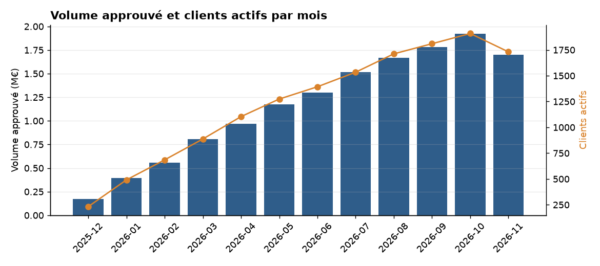
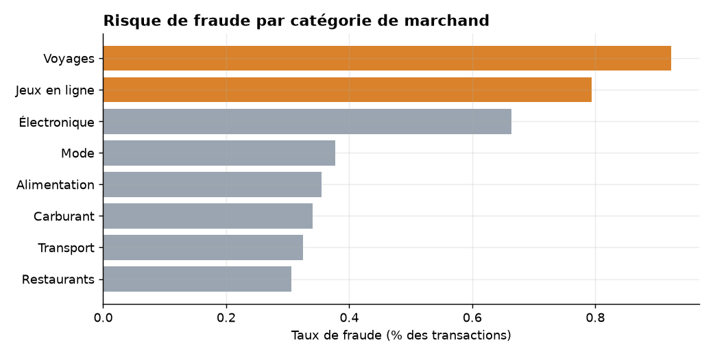
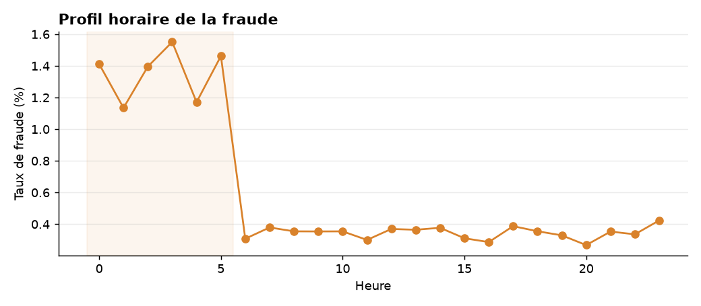
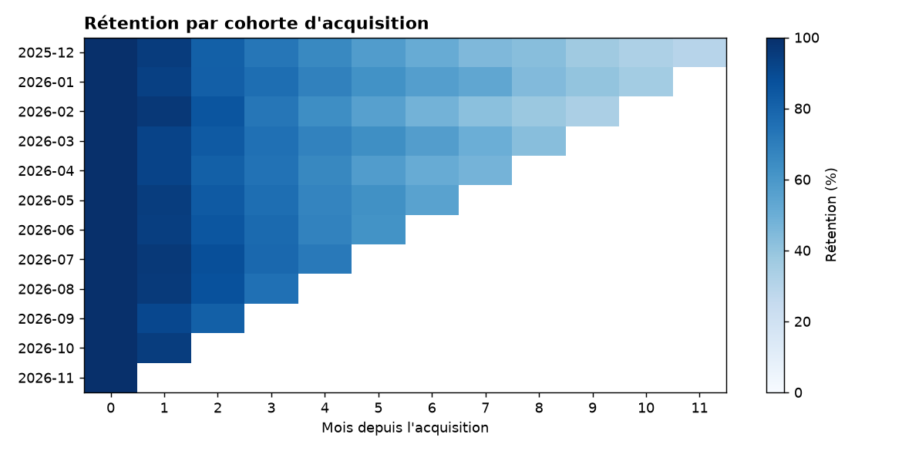

# Rapport d'analyse — activité de paiement carte (12 mois)

> Rapport généré automatiquement par `python -m analytics.report` à partir de données synthétiques.

## Synthèse

- **13 960 305 €** de volume approuvé sur la période, porté à **52 %** par deux catégories : Voyages et Électronique.
- Les catégories les plus risquées sont **Voyages** (0,92 % de fraude) et **Jeux en ligne** (0,79 %), contre 0,37 % en médiane.
- L'**e-commerce** cumule un taux d'acceptation plus bas (93,8 % contre 98,0 % en magasin) et une fraude 2.8 fois plus élevée.
- La nuit (0 h–6 h), le taux de fraude est **3.9 fois** celui de la journée.
- Rétention moyenne : **75 % à 3 mois**, **53 % à 6 mois** après l'acquisition.
- Un client Pro dépense **2.6 fois** plus par mois actif qu'un particulier.

## 1. Évolution mensuelle

| month   |   transactions |   active_customers | approved_volume   | approval_rate   | volume_mom   |
|:--------|---------------:|-------------------:|:------------------|:----------------|:-------------|
| 2025-12 |           2079 |                232 | 171 792 €         | 97,84 %         |              |
| 2026-01 |           4853 |                491 | 394 955 €         | 96,33 %         | 129,90 %     |
| 2026-02 |           6834 |                685 | 556 840 €         | 96,90 %         | 40,99 %      |
| 2026-03 |          10045 |                887 | 807 995 €         | 96,75 %         | 45,10 %      |
| 2026-04 |          12079 |               1104 | 971 111 €         | 97,19 %         | 20,19 %      |
| 2026-05 |          14416 |               1274 | 1 176 311 €       | 96,58 %         | 21,13 %      |
| 2026-06 |          15755 |               1393 | 1 298 543 €       | 96,50 %         | 10,39 %      |
| 2026-07 |          18535 |               1534 | 1 513 474 €       | 96,58 %         | 16,55 %      |
| 2026-08 |          20236 |               1712 | 1 666 308 €       | 96,78 %         | 10,10 %      |
| 2026-09 |          21424 |               1810 | 1 779 481 €       | 96,60 %         | 6,79 %       |
| 2026-10 |          23714 |               1909 | 1 920 839 €       | 96,80 %         | 7,94 %       |
| 2026-11 |          21229 |               1731 | 1 702 656 €       | 96,77 %         | -11,36 %     |

## 2. Risque par catégorie

| category      | approved_volume   | share_of_volume   | fraud_rate   | fraud_amount   |
|:--------------|:------------------|:------------------|:-------------|:---------------|
| Voyages       | 4 393 804 €       | 31,47 %           | 0,92 %       | 51 958 €       |
| Électronique  | 2 872 470 €       | 20,58 %           | 0,66 %       | 23 009 €       |
| Mode          | 1 690 197 €       | 12,11 %           | 0,38 %       | 7 763 €        |
| Alimentation  | 1 530 141 €       | 10,96 %           | 0,35 %       | 5 750 €        |
| Carburant     | 1 260 580 €       | 9,03 %            | 0,34 %       | 4 722 €        |
| Restaurants   | 1 158 418 €       | 8,30 %            | 0,31 %       | 3 725 €        |
| Jeux en ligne | 601 092 €         | 4,31 %            | 0,79 %       | 5 378 €        |
| Transport     | 453 604 €         | 3,25 %            | 0,32 %       | 1 358 €        |

**Recommandation** : renforcer les règles d'authentification (3-D Secure systématique, plafonds) sur les deux catégories en tête du classement de risque, qui pèsent peu en volume mais concentrent une part disproportionnée des montants fraudés.

## 3. Canaux et horaires

| channel             |   transactions | approval_rate   | fraud_rate   | avg_ticket   |
|:--------------------|---------------:|:----------------|:-------------|:-------------|
| Paiement en magasin |          77135 | 97,99 %         | 0,28 %       | 84 €         |
| E-commerce          |          51471 | 93,78 %         | 0,80 %       | 84 €         |
| Sans contact        |          42593 | 98,01 %         | 0,27 %       | 86 €         |

**Recommandation** : un seuil de score plus strict sur la plage 0 h–6 h, en e-commerce en priorité.

## 4. Rétention des clients

**Lecture** : chaque ligne est une cohorte de clients acquis le même mois ; la décroissance le long de la ligne mesure le churn. La perte la plus forte a lieu entre le 2ᵉ et le 4ᵉ mois : c'est la fenêtre où une action de réactivation a le plus d'effet.

## 5. Valeur par segment

| segment     |   customers | spend_per_active_month   |
|:------------|------------:|:-------------------------|
| Pro         |         285 | 1 831 €                  |
| Premium     |         536 | 1 321 €                  |
| Particulier |        2152 | 716 €                    |

## Méthode

Requêtes SQL (DuckDB) dans `sql/kpis.sql`, exécutées sur un schéma en étoile Parquet. Fonctions de fenêtre (`LAG`, `RANK`, `ROW_NUMBER`), agrégats filtrés et analyse de cohortes. Les mêmes tables sont exportables vers Power BI (`python -m analytics.export_powerbi`).
