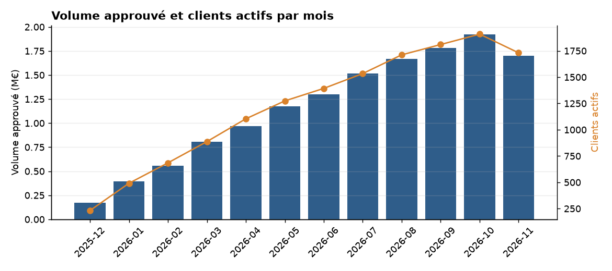
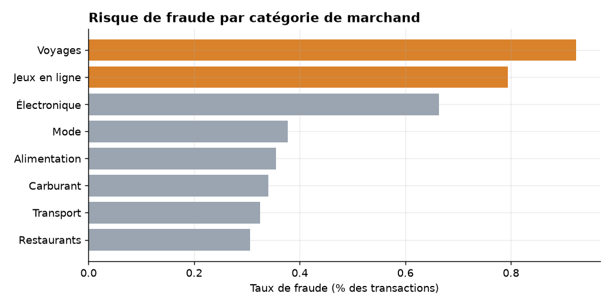
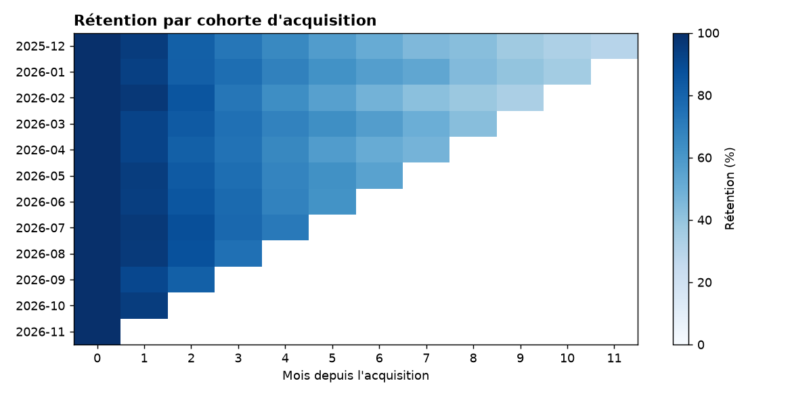

# Analyse et pilotage de l'activité de paiement — SQL · Python · Power BI · Streamlit

Projet de **data analyse** de bout en bout sur 12 mois de transactions carte : KPI en SQL, analyse de cohortes, détection des zones de risque, rapport automatisé, tableau de bord interactif et modèle prêt pour Power BI.

Le domaine (paiements, fraude, acceptation) reprend celui de mon stage chez un éditeur de logiciels bancaires. Les données sont **synthétiques** (≈ 170 000 transactions, 3 000 clients, 600 marchands) et générées localement avec des comportements réalistes : saisonnalité, churn par cohorte, fraude plus forte la nuit et en e-commerce.



## Résultats clés

Extraits du [rapport complet](RAPPORT.md), régénéré à chaque exécution :

- Deux catégories (Voyages, Électronique) portent **52 %** du volume approuvé.
- **E-commerce** : acceptation de 93,8 % contre 98,0 % en magasin, et une fraude 2,8 fois plus élevée.
- La nuit (0 h–6 h), le taux de fraude est **3,9 fois** celui de la journée.
- Rétention des cohortes : **75 % à 3 mois**, **53 % à 6 mois** ; la plus forte perte a lieu entre le 2ᵉ et le 4ᵉ mois.

| Fraude par catégorie | Rétention par cohorte |
|---|---|
|  |  |

## Démarrage rapide

```bash
pip install -r requirements.txt
make all            # données -> rapport RAPPORT.md -> export Power BI -> tests
make dashboard      # tableau de bord sur http://localhost:8501
```

Sans `make` : `python -m analytics.dataset`, `python -m analytics.report`, `streamlit run app.py`.
Avec Docker : `docker build -t kpi . && docker run -p 8501:8501 kpi`

## Contenu

| Livrable | Détail |
|---|---|
| `sql/kpis.sql` | 7 requêtes KPI DuckDB : vue mensuelle avec évolution M-1 (`LAG`), part de volume et rang de risque (`RANK`, agrégats `FILTER`), entonnoir par canal, profil horaire, **rétention par cohorte**, valeur par segment, top 3 marchands par ville (`ROW_NUMBER`). |
| `analytics/report.py` | Rapport Markdown + 4 graphiques. Tous les chiffres sont calculés, aucun n'est écrit en dur. |
| `app.py` | Tableau de bord Streamlit / Plotly : filtres période, catégorie et canal ; 5 KPI ; 4 graphiques ; table détaillée. Requêtes paramétrées. |
| `powerbi/` | Export CSV du schéma en étoile (faits + 3 dimensions dont calendrier) et **mesures DAX** : volume, acceptation, fraude, M-1, YTD, part du volume. |
| `tests/` | Réconciliation SQL ↔ pandas, bornes de la rétention, cohérence des classements. |
| CI | GitHub Actions : lint (ruff), tests, génération du rapport et de l'export. |

## Modèle de données

```
dim_customer (customer_id, segment, city, acquisition_date)
        │
fact_transactions (transaction_id, event_ts, customer_id, merchant_id,
                   channel, amount, is_approved, is_fraud)
        │
dim_merchant (merchant_id, category, city)        dim_date (export Power BI)
```

## Brancher Power BI

1. `python -m analytics.export_powerbi`
2. Power BI Desktop → *Obtenir les données* → Texte/CSV → `powerbi/data/*.csv` (séparateur `;`)
3. Créer les relations décrites en tête de `powerbi/measures.dax`, puis coller les mesures.

## Projet lié

Les données de ce type sont produites en amont par mon pipeline ELT : [transactions-elt-pipeline](https://github.com/Dhimen-z/transactions-elt-pipeline) (DuckDB, dbt, Airflow, contrôles qualité).

## Auteur

Zidane DHIMEN — élève ingénieur ISIMA (IA & optimisation), Master ICS. [LinkedIn](https://www.linkedin.com/in/zidane-dhimen-bb7416373)
